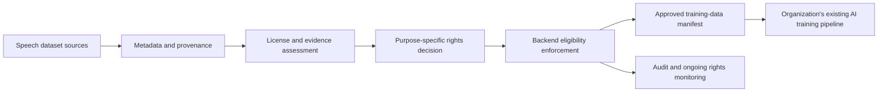

# BhashaTrust AI

BhashaTrust AI is a local dataset-rights governance workspace. It evaluates
whether registered datasets may be used for a requested purpose and context,
records signed rights assertions, and produces an auditable decision trail.
It addresses **WEB3-04: Rights-Gated Regional-Language Dataset Licensing for AI
Training** at **Quant-A-Maze 3.0** by applying the licensing decision before a
dataset can enter optimization or a training manifest.
It is a prototype: its demo cost data is synthetic, and a valid signature or
blockchain hash does not establish legal ownership or the truth of a claim.

## Before Voice AI Can Learn: Verify the Rights to Its Speech Data

Speech recognition, transcription, conversational audio, translation, and
speech generation depend on appropriate datasets as well as model architectures,
evaluation, and infrastructure. BhashaTrust AI is a complementary governance
layer for an organization's own speech-data ingestion process; it is not a
speech model, does not improve another company's model quality, and does not
control Google's, OpenAI's, or any other company's private training systems.



An integrating organization must enforce the eligibility decision in its own
ingestion controller. This standalone workspace cannot prevent data use outside
that integration.

## What is implemented

- **Dataset registry and licensing decisions:** SQLite-backed dataset records,
  conservative purpose/commercial/redistribution/derivative/geography/expiry/
  revocation checks, and evidence provenance.
- **Signed rights evidence:** Ed25519 signature verification for submitted
  rights assertions. A valid signature proves record integrity only; it is a
  user-supplied claim, not independent legal evidence or proof of authority.
  Stored signatures are rechecked when records are read and when decisions are
  evaluated; editing a signed payload invalidates that signature.
  The dashboard accepts an externally signed payload, public key, and signature;
  it never asks for or handles a private key.
- **Evidence gate:** public dataset registration cannot set independent
  verification. Without an authenticated independent-review workflow, claims
  require review and cannot authorize training automatically.
- **Audit and manifests:** local hash-chained audit events and timestamped
  accepted, rejected, and needs-review corpus manifests.
- **Planning:** a purpose-scoped cost-allocation gate that rejects ineligible
  datasets before pricing or audit writes; synthetic cost allocation, a deterministic exact local
  knapsack optimizer, and an optional explicitly confirmed QpiAI Opt platform
  MILP solver.
- **Quantum experiment:** a seeded local QAOA/statevector experiment based on
  the same budgeted dataset-selection QUBO, with a classical baseline; optional
  QCloud execution requires explicit request confirmation and credentials.
- **Rights ledger:** an optional local Hardhat contract that stores hashes
  only. Anchoring is an explicit action and does not determine licensing
  decisions.
- **Dashboard:** a React interface for datasets, rights, ledger status, costs,
  optimization, quantum experiments, manifests, audit events, and evaluation
  coverage.

## Technology and layout

- Python, FastAPI, Pydantic, and SQLite in `backend/`.
- React 19 and Vite 6 in `frontend/`.
- Solidity, Hardhat 2, ethers, and OpenZeppelin in `blockchain/`.
- Design notes for optimization and quantum experiments in `docs/`.
- Generated manifests in `manifests/`.

The backend initializes the SQLite schema on startup and seeds the two
synthetic demo datasets only when the configured database is empty. By default
the database is `backend/data/bhashatrust.db`; set `BHASHATRUST_DB_PATH` to use
a different file. Startup applies additive schema migrations and does not reset
existing database files. Previously stored evidence flags are not promoted to
independently verified; older rows default to unverified pending review.

### Provenance metadata

Dataset registration accepts optional source/provider name and URL, source
dataset identifier and release, language variety, modalities, collection
method and period, contributor claim, license version, intended-use notes,
known restrictions, and provenance notes. The existing `owner` value is
displayed as a registrant rights-holder claim. When any provenance fields are
provided, the backend labels them `REGISTRANT_SUPPLIED`, records the metadata
origin and server timestamp, and keeps that state separate from evidence
reviews and purpose-specific eligibility. Older rows receive `NOT_RECORDED`
and null values; the migration does not infer historical provenance.

Source URLs are validated as HTTP(S) metadata and are never fetched; registration
does not download dataset contents. Source pages, license labels, and claimant
statements are not independent proof of rights. A separate, read-only
dataset-evidence status endpoint shows review state without exposing evidence
references outside the authorized review queue.

## Local setup

Use Python 3.14 for the backend environment (the full backend suite was
verified with it here), plus Node.js and npm for the dashboard. The copied
virtual environment was created with Python 3.12, but its interpreter path
belongs to the previous computer. Node.js 24 is documented for the local
Hardhat setup.

From the project root in PowerShell, create a fresh virtual environment on this
computer without modifying the copied environment, then install the backend
dependencies:

```powershell
py -3.14 -m venv backend\.venv-local
.\backend\.venv-local\Scripts\python.exe -m pip install -r backend\requirements.txt
```

In one PowerShell terminal, start FastAPI from the project root:

```powershell
.\backend\.venv-local\Scripts\python.exe -m uvicorn backend.main:app --host 127.0.0.1 --port 8000
```

In a second terminal, start the dashboard:

```powershell
Set-Location .\frontend
npm ci
npm run dev
```

Open the local Vite URL printed in the terminal (normally
`http://127.0.0.1:5173`). FastAPI's interactive API documentation is available
at `http://127.0.0.1:8000/docs`. The dashboard defaults to
`http://127.0.0.1:8000`; `frontend/.env.example` documents the optional
`VITE_API_BASE_URL` override.

Do not reuse a copied `backend/.venv` from another computer. A virtual
environment stores machine-specific interpreter paths; recreate it as above
when moving the project.

## Trusted evidence review (development configuration)

Dataset owner names and evidence references are submitter-provided claims.
Evidence submission accepts HTTPS references only, stores metadata rather than
files, and never fetches the referenced URL. References are shown as plain text
to authorized reviewers and are not included in the audit-chain payload.

The review queue is disabled unless the backend has both
`BHASHATRUST_REVIEWER_ID` and a random `BHASHATRUST_REVIEWER_TOKEN` of at least
32 characters. Configure them in the backend process environment or the
ignored `backend/.env` file before starting FastAPI. For a local PowerShell
session, generate and assign a cryptographically random 32-byte token (43
URL-safe characters) and keep the same terminal open for FastAPI:

```powershell
$env:BHASHATRUST_REVIEWER_ID = "your-configured-reviewer-id"
$env:BHASHATRUST_REVIEWER_TOKEN = (& .\backend\.venv-local\Scripts\python.exe -c "import secrets; print(secrets.token_urlsafe(32))")
Write-Output "Local reviewer token (copy only into the local reviewer page): $env:BHASHATRUST_REVIEWER_TOKEN"
.\backend\.venv-local\Scripts\python.exe -m uvicorn backend.main:app --host 127.0.0.1 --port 8000
```

The token is assigned to the backend process and printed once in that local
terminal so it can be entered in the dashboard's **Evidence review** page. Do
not paste it into chat, logs, frontend settings, or source files. The page
holds it in memory and sends it in an authorization header. Keep `.env` files
containing credentials local; never place reviewer credentials in any `VITE_*`
setting, which Vite may embed in frontend assets. The configured reviewer ID
is the actor recorded by the backend; a request cannot choose that identity.
Without valid server configuration reviewer APIs fail closed. This shared
bearer-token mechanism is for a local development demo, not production
identity management; production use requires TLS, managed secret storage,
rotation, rate limiting, and individual reviewer authentication.

The local development database has a historical evidence submission for
dataset 3 whose type is explicitly `Synthetic demo license reference` and
whose reference is on `example.org`. It is placeholder metadata, not evidence.
Its row and original `evidence_submitted` audit event are preserved; the
existing schema has no separate synthetic-provenance column, so the app
prevents that explicit placeholder type from being approved. Isolated tests
use their own clearly labeled synthetic fixtures. Do not treat the historical
record as evidence or use it to authorize a dataset.
The currently running FastAPI process was started without `--reload`, so it
must be restarted before relying on code changes made after that process
started. Do not start a second server on port 8000; restart the existing one
only when appropriate, and keep reviewer access disabled until its real local
configuration is supplied.

On startup, legacy `evidence_independently_verified` flags without a complete
set of approved evidence submissions are demoted to unverified; dataset rows
and their audit history are retained.

Evidence workflow routes are `POST /api/datasets/{dataset_id}/evidence`,
`GET /api/reviewer/status`, authenticated `GET /api/review/queue`, and
authenticated `POST /api/evidence/{evidence_id}/review`.

Review outcomes are internal judgments about the submitted evidence and do not
prove ownership, signer authority, or legal validity. A dataset is marked
independently reviewed only after every current evidence submission is
approved. New evidence or a new signed rights claim reopens that review. The
licensing engine still independently checks purpose, commercial permission,
expiry, revocation, geography, redistribution, derivative-work terms, and
conflicting claims; optimizer and manifests consume those backend decisions.

## Optional integrations

The core registry, licensing, audit, manifests, local optimizer, and local
quantum experiment do not require cloud credentials.

- **QpiAI Opt:** the platform optimizer uses the official `qpiai-opt` 0.0.9
  SDK. The adapter reads `QPIAI_OPT_API_KEY` from the backend process
  environment, `backend/.env`, or project-root `backend.env`, then passes it
  directly to the SDK's `Client(api_key=...)`. The installed SDK defaults to
  its hosted Opt API and a 60-second HTTP timeout. A platform request also
  requires `confirm_remote_job: true` and may consume credits; otherwise the
  deterministic local optimizer runs. This integration is not represented as
  remotely verified until an authorized platform request has completed.
  Existing `backend.env` entries named `QPIAI_OPT_ACCESS_TOKEN` and
  `QPIAI_OPT_API_URL` are not read by this adapter; do not assume they
  authenticate or configure it. Confirm the provider's expected credential
  type and API endpoint before configuring any remote run.
- **QCloud:** copy the relevant settings from `backend/.env.example` to
  `backend/.env` and set `API_KEY` only if you intend to run a confirmed remote
  experiment. Local simulation does not authenticate or submit a cloud job.
  The project keeps its `qpiai-quantum` 0.7.5 pin instead of installing
  `qpiai-opt[quantum]`, whose current extra pins `qpiai-quantum` 0.3.0.
- **Local RightsLedger:** follow [the blockchain guide](./blockchain/README.md).
  It requires a local Hardhat node, a local contract deployment, and the
  deployed contract and owner addresses in `backend/.env`. No private key is
  required or requested by the backend.

Keep credentials in local environment files or process environment variables;
never put them in frontend settings or commit them. Do not overwrite an
existing environment file when setting up the project.

The root `.env.example` is a template, not an active credential source. Keep
its credential values blank and use only locally obtained credentials in
ignored files or process environment. A credential-like sample value was
removed from that template during the QpiAI readiness audit; if it was a real
credential and was ever shared or committed, revoke and rotate it with the
provider.

## Checks

Run the backend tests from the project root:

```powershell
.\backend\.venv-local\Scripts\python.exe -m pytest backend\tests -q
```

The provenance migration and isolated synthetic Kannada A/B/C demonstration
can be run separately:

```powershell
.\backend\.venv-local\Scripts\python.exe -m pytest backend\tests\test_provenance.py backend\tests\test_ingestion.py -q
```

The A/B/C test uses a temporary SQLite database and temporary manifest folder.
Its reviewer identity/token exist only in the isolated test process. All
fixture datasets and evidence are explicitly fictional; the accepted manifest
contains `synthetic_test_output: true` and fixture entries are marked
`synthetic_test_fixture: true`. Pytest removes the temporary database and
manifest output at teardown. No live reviewer credential or registry row is
used.

Build the dashboard:

```powershell
npm run build --prefix frontend
```

Compile and test the local contract:

```powershell
npm ci --prefix blockchain
npm run compile --prefix blockchain
npm test --prefix blockchain
```

The blockchain tests use an in-memory Hardhat network. They do not require a
public RPC endpoint or cloud credentials.

## 3–5 minute hackathon demo walkthrough

The demo data is synthetic and contains no private corpus content. Start the
backend and dashboard with the commands above, then:

1. For a live UI walkthrough, open **Datasets** and inspect the seeded Hindi and Marathi examples. Their
   evidence is either a registry assertion or unverified; neither is presented
   as independently verified.
2. Open **Rights**. Evaluate the Hindi sample for `research_training` in
   research context: it returns **NEEDS_REVIEW**, because no trusted reviewer
   has independently verified the evidence. Evaluate the same dataset for
   commercial training: it returns **REJECTED**, because research-only purpose
   does not authorize commercial training.
3. On **Datasets**, show the registration form for a synthetic Kannada entry
   with a registrant-supplied owner/rights-holder claim. The claim is not
   verification. To avoid changing the persistent judge database, use the
   isolated backend tests to demonstrate actual registration and evidence
   submission; those fixtures live in temporary databases and use only
   `example.org` placeholders clearly labeled as synthetic.
4. Open **Evidence review**. With reviewer credentials absent, the page
   explicitly reports that review access is unavailable and exposes no
   reviewer actions. This is the expected fail-closed demo state. The API tests
   separately verify unauthorized and unconfigured review attempts, plus
   authorized approve/reject/request-more-evidence outcomes using test-only
   credentials in isolated fixtures.
5. In **Rights**, request redistribution or derivative works for an entry
   whose permission is unspecified or denied. The result is respectively
   **NEEDS_REVIEW** or **REJECTED**.
6. Open **Manifests** and generate manifests for research training. Entries
   carry their decision, requested scope, evidence status, and audit reference;
   review/rejected datasets do not appear in the accepted manifest.
7. Open **Audit** to inspect registration and decision events and verify the
   local hash chain. Run **Optimizer** to see that only currently approved
   datasets can become candidates. With reviewer access unconfigured, the
   expected safe result is an empty selection rather than a fabricated
   optimization result.
8. Open **Cost allocation**. The requested purpose and rights scope are checked
   by the backend before prices are returned or an allocation event is written.
   The current unverified registry should show no selectable datasets; a
   direct request for one is rejected with its decision reasons.
9. Describe the optimizer as a budget-constrained binary knapsack: maximize
   dataset utility subject to total licensing cost within budget; backend
   licensing decisions filter the candidate set before optimization.

To demonstrate all three decision outcomes without changing live data, run
the isolated test command above. It registers three fictional Kannada speech
fixtures through the actual API, submits synthetic evidence references, and
uses test-only reviewer settings in the temporary environment:

- All three are evaluated for `commercial_speech_training`, commercial
  context, geography `IN`, with redistribution and derivative-work use not
  requested, and a `$200.00` budget.
- **A — ACCEPTED:** synthetic commercial training terms and approved test
  evidence satisfy the configured test scope; only this fixture enters the
  accepted manifest and its allocation succeeds.
- **B — REJECTED:** synthetic evidence is approved in the isolated test, but
  commercial use is explicitly prohibited; the decision and allocation return
  `COMMERCIAL_USE_NOT_PERMITTED`.
- **C — NEEDS_REVIEW:** evidence remains pending and commercial permission is
  unspecified; the decision and allocation include
  `COMMERCIAL_PERMISSION_UNSPECIFIED` and `EVIDENCE_UNVERIFIED`.

The test asserts manifest membership and synthetic-output markers, rejected
allocation responses without successful-allocation audit events, and audit
chain integrity. It is not a legal review or a claim that any real Kannada
source, consent, license, or transaction was verified.

The local QAOA experiment uses the same eligible-dataset budgeted selection
model and is reproducibly tested against the exact classical baseline. The
clean dashboard seed has no independently approved datasets, so it will not
produce a quantum selection until trusted evidence review exists. QpiAI Opt
platform calls and QCloud simulator jobs are not run in this demo; they require
credentials, explicit confirmation, and approved candidates. No remote solver
or quantum result, performance gain, or quantum advantage has been measured.

The trusted-review workflow is implemented but intentionally unavailable until
the project operator configures a real reviewer identity and random token
locally. Do not enter fabricated credentials, approve the historical placeholder,
or submit made-up evidence for a successful-looking demo. Approval is an
internal review outcome, not a legal guarantee. No QpiAI remote call, QCloud
job, quantum advantage claim, or public-chain transaction is part of this demo.

## Security and integration boundaries

The API has no user authentication or authorization layer. Keep it bound to
`127.0.0.1` for the demo; CORS restrictions do not replace authentication, and
this prototype must not be exposed to an untrusted network. Optional credentials
belong only in ignored local environment files or process environment variables.
QpiAI Opt and QCloud remote calls are not required for the demo and should not
be run without explicit approval. The rights contract is tested on Hardhat's
in-memory chain; the project does not use a public blockchain.
